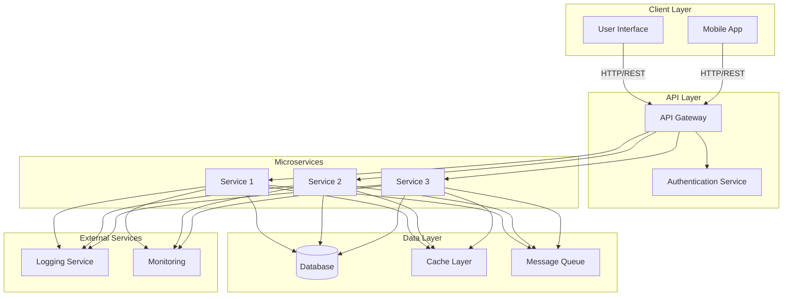

# Architecture Overview

This document provides a visual overview of the micro-project system architecture.

## System Architecture Diagram

## Component Description

| Component | Description |
|-----------|-------------|
| **Client Layer** | Frontend applications including web UI and mobile apps |
| **API Gateway** | Single entry point for all client requests |
| **Authentication Service** | Handles user authentication and authorization |
| **Microservices** | Independent services handling specific business logic |
| **Database** | Central data storage for all services |
| **Cache Layer** | In-memory caching for improved performance |
| **Message Queue** | Asynchronous communication between services |
| **Logging Service** | Centralized logging for all microservices |
| **Monitoring** | System health and performance monitoring |

## Key Principles

- **Scalability**: Each microservice can be scaled independently
- **Resilience**: Services are decoupled through message queues
- **Security**: Centralized authentication and authorization
- **Observability**: Comprehensive logging and monitoring
- **Maintainability**: Clear separation of concerns
